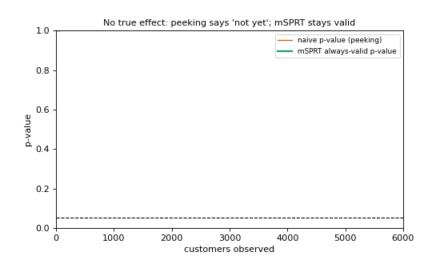
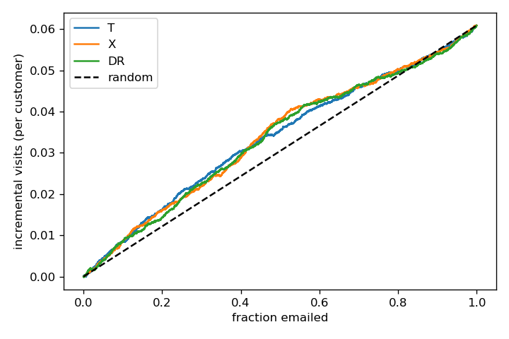

# experiment-to-decision

A small, tested toolkit for the full experimentation workflow: **design → health-check → analyze → target**.



*Both tests watch the same experiment with **no true effect**. The naive p-value dips below 0.05 if you
check often enough; the mSPRT p-value does not. This one stream was picked for illustration (regenerate with
`python examples/make_gif.py`). The rates over 300 simulated null experiments, checking after every
observation up to n=3,000: naive test **39%** false positives, mSPRT **2.7%** (nominal 5%).*

| Stage | Module | What it does |
|---|---|---|
| Design | `power` | Sample size / minimum detectable effect (means and proportions) |
| Health | `diagnostics` | Sample Ratio Mismatch (chi-square) |
| Analyze | `variance` | ATE with CIs; CUPED variance reduction |
| Monitor | `sequential` | mSPRT always-valid p-values (safe to peek) |
| Target | `uplift` | T-, X- and doubly-robust learners for heterogeneous effects |
| Evaluate | `evaluate` | Qini curve, Qini area (AUUC), uplift-by-decile |
| Decide | `policy` | Profit-based targeting with out-of-sample, bootstrapped gain vs. treat-all |
| Test | `synthetic` | Data with known ground-truth CATE |

The Python package is named `causalkit` (`from causalkit import cuped_ate, DRLearner`).

## Quickstart
```bash
pip install -e ".[dev]"
pytest                      # 15 tests, incl. CI-coverage and peeking Type-I checks
python examples/demo.py     # reproduces the numbers below, writes docs/qini.png
```

## Interactive demo
```bash
pip install -e ".[app]"
streamlit run app/streamlit_app.py
```
Four tabs on simulated data with a known ground truth: **Power** (sample size curves), **CUPED**
(slide the pre-period correlation and watch variance reduction follow), **Peeking** (naive vs mSPRT
false-positive rates for your check frequency), and **Targeting** (out-of-fold uplift scores, Qini curve,
and a profit policy with a bootstrapped "targeted minus treat-everyone" interval). The real Hillstrom
analysis stays in `examples/` because that dataset is not redistributed here.

## Results (synthetic data with known ground truth, n=30k)
- **CUPED** cut ATE standard error from 0.032 to 0.018 (**~68% variance reduction**), same estimand.
- **mSPRT** stopped at 5,250 of 30,000 users on a real effect; under the null, peeking after every
  observation gave a false-positive rate below 8% in the test suite (nominal 5%).
- **Uplift models** (10k holdout): correlation with true CATE 0.95 (T), 0.99 (X), 0.99 (DR).


## Real data: Hillstrom email experiment (64k customers, randomized)
`python examples/hillstrom.py` (download the CSV to `data/hillstrom.csv` first; it is git-ignored).
- Randomization check passed (SRM p=0.90). Any email lifted site visits by **+6.1 pts** (SE 0.28 pts);
  men's email +7.7 pts, women's +4.5 pts, versus 10.6% baseline.
- **CUPED did nothing here** (0.4% variance reduction): purchase history barely predicts visits, so
  there is no variance to remove. It only helps with a strong pre-period covariate.
- Uplift models (5-fold out-of-fold, outcome = visit) beat random targeting: Qini area 0.0033 (T),
  0.0036 (X), 0.0036 (DR) vs 0.0007 random. **The three learners are statistically indistinguishable**
  (fold SD 0.0014-0.0028), and the decile table is noisy rather than cleanly monotone, so the
  heterogeneity signal is real but weak in these 8 features.



### Profit-based targeting (`examples/hillstrom_policy.py`)
`evaluate_policy` picks the share of customers to email on one half of the data, scores it on the other
half, and bootstraps the whole procedure (IPW estimates, so no model of the outcome is trusted).
Value = spend, cost swept from $0.10 to $0.70 per email (average email uplift in spend is about $0.60):
- **Emailing everyone** earns about $0.50/customer at a $0.10 cost, falls to about $0.10 at $0.50, and loses money at $0.70.
- **Targeting did not significantly beat emailing everyone at any cost level.** Every interval for
  "targeted minus email-all" includes zero (e.g. at $0.70: +0.05 to +0.14 point estimates, CIs spanning -0.13 to +0.38).
  At high cost the point estimates favor targeting, but 64k customers with heavy-tailed spend cannot confirm it.
- Takeaway: on this dataset the decision is driven by **email cost vs. average uplift**, not by the models.
  The tool's contribution is saying so with calibrated uncertainty instead of reporting an optimistic number.

## Validation, not just code
Tests check statistical *properties*: CUPED 95% CIs cover the truth 90-99% of the time over 200
simulated experiments, mSPRT holds its error rate under continuous peeking, and learners must beat a
random ranking on holdout Qini.

## Caveats
- The synthetic results are easy by construction; the Hillstrom section is the realistic benchmark.
- mSPRT uses a plug-in variance estimate and needs ~30 users per arm before it starts.
- Learners assume a randomized experiment (propensity = observed treated share).

## License
MIT, see [LICENSE](LICENSE).
