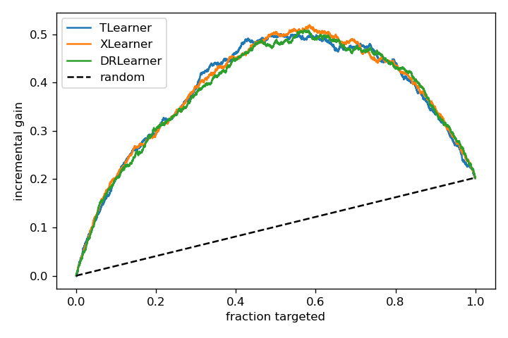

# causalkit

A small, tested toolkit for the full experimentation workflow: **design → health-check → analyze → target**.

| Stage | Module | What it does |
|---|---|---|
| Design | `power` | Sample size / minimum detectable effect (means and proportions) |
| Health | `diagnostics` | Sample Ratio Mismatch (chi-square) |
| Analyze | `variance` | ATE with CIs; CUPED variance reduction |
| Monitor | `sequential` | mSPRT always-valid p-values (safe to peek) |
| Target | `uplift` | T-, X- and doubly-robust learners for heterogeneous effects |
| Evaluate | `evaluate` | Qini curve, Qini area (AUUC), uplift-by-decile |
| Test | `synthetic` | Data with known ground-truth CATE |

## Quickstart
```bash
pip install -e ".[dev]"
pytest                      # 12 tests, incl. CI-coverage and peeking Type-I checks
python examples/demo.py     # reproduces the numbers below, writes docs/qini.png
```

## Results (synthetic data with known ground truth, n=30k)
- **CUPED** cut ATE standard error from 0.032 to 0.018 (**~68% variance reduction**), same estimand.
- **mSPRT** stopped at 5,250 of 30,000 users on a real effect; under the null, peeking after every
  observation gave a false-positive rate below 8% in the test suite (nominal 5%).
- **Uplift models** (10k holdout): correlation with true CATE 0.95 (T), 0.99 (X), 0.99 (DR).



## Validation, not just code
Tests check statistical *properties*: CUPED 95% CIs cover the truth 90-99% of the time over 200
simulated experiments, mSPRT holds its error rate under continuous peeking, and learners must beat a
random ranking on holdout Qini.

## Caveats
- Results above are on synthetic data, where the effect is easy to recover. Real-data results
  (Criteo / Hillstrom) are the next step and will be much noisier.
- mSPRT uses a plug-in variance estimate and needs ~30 users per arm before it starts.
- Learners assume a randomized experiment (propensity = observed treated share).
